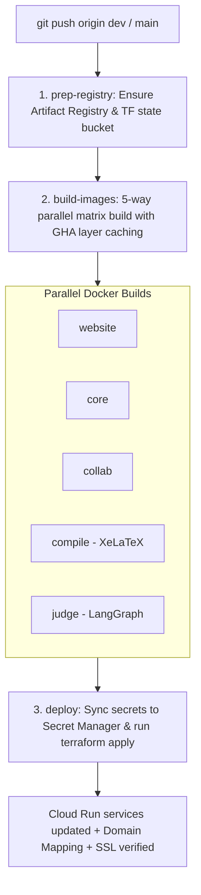

# External Services, GCP & Deployment Setup Guide

This guide covers setting up the Google Cloud Platform (GCP) infrastructure, custom domain with SSL, and Social Login OAuth applications required to run **Engineering Notebook** locally and in production.

> **Need help?** If you run into any issues or need access to existing developer apps, reach out to **Andrew Needham** at `aneedham0577@gmail.com`.

---

## 1. Overview & Architecture

To keep idle hosting costs at **$0/month**, all 5 services run on **Cloud Run** with automatic scale-to-zero (`min-instances: 0`):

| Service | Source | Role | Public Access |
| :--- | :--- | :--- | :--- |
| `website` | `website/Dockerfile` | Next.js UI + Better Auth | Yes (`allUsers`) |
| `core` | `services/core/Dockerfile` | Fastify API, RBAC, Metadata & Storage authority | Yes (`allUsers`) |
| `collab` | `services/collab/Dockerfile` | Hocuspocus Yjs WebSocket server | Yes (`allUsers`) |
| `compile` | `services/compile/Dockerfile` | LaTeX / XeLaTeX PDF compiler worker | No (Pub/Sub pull) |
| `judge` | `services/judge/Dockerfile` | Python / LangGraph rubric & grading worker | No (Pub/Sub pull) |

### Supporting GCP Managed Resources
1. **Artifact Registry:** Docker repository storing container images for all 5 services.
2. **Firestore (Native mode):** Primary metadata store (`user`, `session`, `account`, `org`, `notebook`, `entry`, etc.).
3. **Cloud Storage (GCS):** Private bucket for TipTap JSON documents, Yjs snapshots, image assets, compiled PDFs, and rubric sources.
4. **Pub/Sub:** Topics and pull subscriptions (`notebook-jobs-compile` and `notebook-jobs-judge`) for background compile and evaluation tasks.
5. **Secret Manager:** Synchronizes app secrets (`better-auth-secret`, `internal-service-secret`, and OAuth client secrets) without manual GCP console entry.

---

## 2. One-Time GCP Bootstrap & Workload Identity

We use keyless **Workload Identity Federation** so GitHub Actions deploys securely without storing long-lived GCP service account keys in GitHub.

Run the bootstrap script once per GCP project (`dev` and `prod`):
```bash
./infra/terraform/bootstrap-gcp.sh <GCP_PROJECT_ID> <GITHUB_OWNER/GITHUB_REPO>
```

This script:
1. Enables required GCP APIs (`iam`, `sts`, `run`, `firestore`, `storage`, `pubsub`, `secretmanager`, `artifactregistry`).
2. Creates the `github-deploy` service account with required IAM roles (`run.admin`, `artifactregistry.admin`, `secretmanager.admin`, etc.).
3. Creates the Workload Identity Pool and Provider mapped to your GitHub repository.
4. Outputs the exact `GCP_SERVICE_ACCOUNT` and `GCP_WORKLOAD_IDENTITY_PROVIDER` values to paste into your GitHub Environment Secrets.

---

## 3. Custom Domain & DNS Setup (`APP_URL`)

If using a custom domain (e.g. `engen-dev.msoevex.com` or `app.msoevex.com`), Terraform automatically provisions the Cloud Run domain mapping and requests a Google-managed SSL certificate when `APP_URL` is set to a non-`*.run.app` URL.

### Step 1: Verify Domain Ownership in Google Search Console
Google Cloud Run requires proof of domain ownership before allowing any service to bind to it:
1. Open [Google Search Console](https://search.console.google.com/search-console/welcome) (sign in with your Google Account).
2. Add your root domain (e.g. `msoevex.com`) as a **Domain Property**.
3. Add the verification TXT record to your DNS provider (Cloudflare, Namecheap, GoDaddy, Route53, etc.) and click **Verify**. Verifying the root domain covers all current and future subdomains (`engen-dev.msoevex.com`, `app.msoevex.com`, etc.).

### Step 2: Authorize the GitHub Deploy Service Account
1. In Search Console, navigate to **Settings** → **Users and permissions** → **Add user**.
2. Enter your deploy service account email:
   ```
   github-deploy@<PROJECT_ID>.iam.gserviceaccount.com
   ```
3. Set the permission level to **Owner**. This allows Terraform to administer domain mappings on your behalf.

### Step 3: Add the DNS CNAME Record
In your DNS provider:
- **Type:** `CNAME`
- **Name / Host:** `engen-dev` (or your subdomain)
- **Target / Value:** `ghs.googlehosted.com`
- **Proxy Status:** DNS Only / Gray Cloud (if using Cloudflare, turn proxy OFF until Google's certificate is issued).

> [!TIP]
> If domain verification is pending, set `APP_URL` to your Cloud Run URL (`https://website-<hash>-uc.a.run.app`). Terraform will skip domain mapping and deploy all services immediately.

---

## 4. Social Login OAuth Apps

Authentication is powered by **Better Auth** on the Next.js `website` service. Create developer apps for each provider using these callback URL patterns:

- **Local development:** `http://localhost:3000/api/auth/callback/<provider>`
- **Production / Dev Cloud:** `https://<your-custom-domain>/api/auth/callback/<provider>`

### Google (GCP OAuth 2.0)
1. Open **Google Cloud Console → APIs & Services → Credentials**.
2. Create an **OAuth 2.0 Client ID** (Type: **Web application**).
3. **Authorized JavaScript origins:**
   - `http://localhost:3000`
   - `https://<your-custom-domain>`
4. **Authorized redirect URIs:**
   - `http://localhost:3000/api/auth/callback/google`
   - `https://<your-custom-domain>/api/auth/callback/google`
5. Save `GOOGLE_CLIENT_ID` and `GOOGLE_CLIENT_SECRET`.

### GitHub
1. Open **GitHub → Settings → Developer settings → OAuth Apps → New OAuth App**.
2. **Homepage URL:** `http://localhost:3000` (or `https://<your-custom-domain>`).
3. **Authorization callback URL:**
   - `http://localhost:3000/api/auth/callback/github` (use a dedicated app for production with `https://<your-custom-domain>/api/auth/callback/github`).
4. Save `GITHUB_CLIENT_ID` and `GITHUB_CLIENT_SECRET`.

### Discord
1. Open **Discord Developer Portal → Applications → OAuth2**.
2. **Redirects:**
   - `http://localhost:3000/api/auth/callback/discord`
   - `https://<your-custom-domain>/api/auth/callback/discord`
3. Save `DISCORD_CLIENT_ID` and `DISCORD_CLIENT_SECRET`.

### LinkedIn
1. Open **LinkedIn Developer Portal → My Apps → Auth**.
2. Under **Products**, enable **Sign In with LinkedIn using OpenID Connect**.
3. **Authorized redirect URLs:**
   - `http://localhost:3000/api/auth/callback/linkedin`
   - `https://<your-custom-domain>/api/auth/callback/linkedin`
4. Save `LINKEDIN_CLIENT_ID` and `LINKEDIN_CLIENT_SECRET`.

---

## 5. GitHub Environments, Secrets & Variables

We use **GitHub Environments (`dev` and `prod`)** as the single source of truth for deployment credentials:

- **`dev` branch** → Deploys to `dev` environment (`engen-dev`)
- **`main` branch** → Deploys to `prod` environment (`engen-prod`)

### Environment Secrets (**Settings → Environments → `<env>` → Secrets**)

| Secret Name | Description |
| :--- | :--- |
| `GCP_WORKLOAD_IDENTITY_PROVIDER` | Output from `bootstrap-gcp.sh` |
| `GCP_SERVICE_ACCOUNT` | Output from `bootstrap-gcp.sh` (`github-deploy@...`) |
| `BETTER_AUTH_SECRET` | 32+ char random string (`openssl rand -base64 32`) |
| `INTERNAL_SERVICE_SECRET` | 32+ char shared secret (`openssl rand -base64 32`) |
| `GOOGLE_CLIENT_SECRET` | Google OAuth client secret |
| `OAUTH_GITHUB_CLIENT_SECRET` | GitHub OAuth client secret (renamed to avoid `GITHUB_` prefix) |
| `DISCORD_CLIENT_SECRET` | Discord OAuth client secret |
| `LINKEDIN_CLIENT_SECRET` | LinkedIn OAuth client secret |

> [!NOTE]
> The GitHub Actions pipeline automatically syncs these secrets into **GCP Secret Manager** during deployment. You do not need to enter them manually in the GCP Console.

### Environment Variables (**Settings → Environments → `<env>` → Variables**)

| Variable Name | Example Value | Description |
| :--- | :--- | :--- |
| `GCP_PROJECT_ID` | `engen-dev` | Target GCP project ID |
| `GCP_REGION` | `us-central1` | Cloud Run and Artifact Registry region |
| `APP_URL` | `https://engen-dev.msoevex.com` | Base public URL (must include `https://`) |
| `GOOGLE_CLIENT_ID` | `...apps.googleusercontent.com` | Google OAuth Client ID |
| `OAUTH_GITHUB_CLIENT_ID` | `...` | GitHub OAuth Client ID |
| `DISCORD_CLIENT_ID` | `...` | Discord OAuth Client ID |
| `LINKEDIN_CLIENT_ID` | `...` | LinkedIn OAuth Client ID |

---

## 6. CI/CD & Deployment Workflow

The deployment workflow (`.github/workflows/deploy.yml`) is fully automated on git push:



1. **`prep-registry`**: Initializes the Terraform state bucket in GCS and ensures Artifact Registry exists.
2. **`build-images`**: Runs 5 parallel runners using `docker/build-push-action` with GitHub Actions cache (`type=gha`), speeding up builds from ~15 minutes to under 2 minutes.
3. **`deploy`**: Syncs secrets to Secret Manager, mounts IAM permissions, and runs `terraform apply` to provision or update services.
